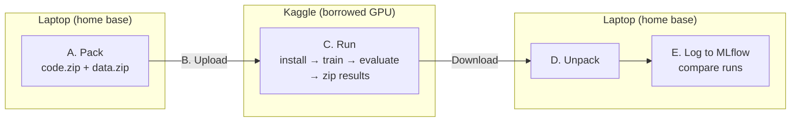
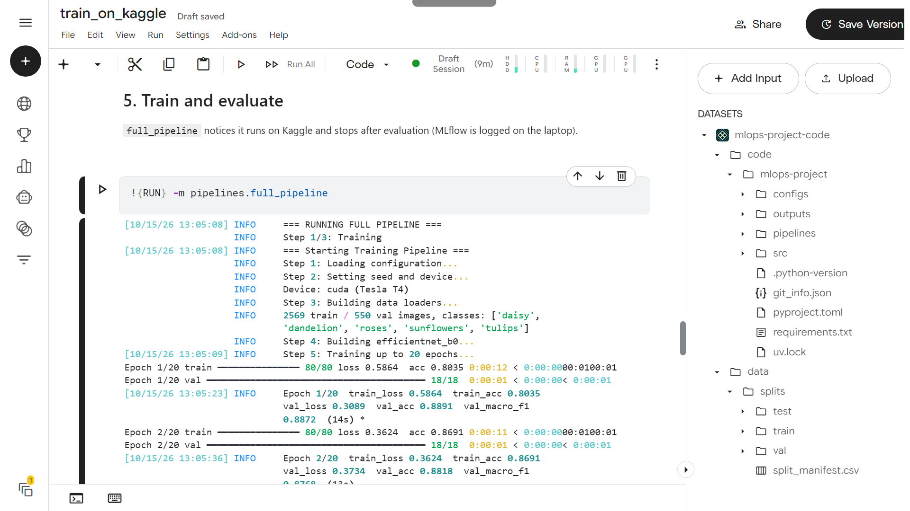
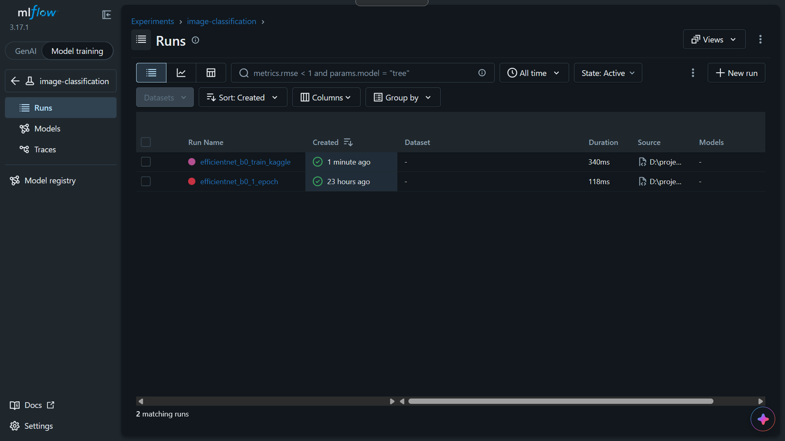
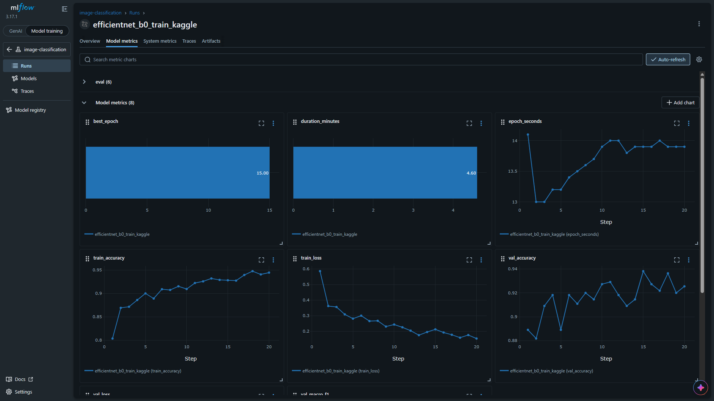

# Local MLOps Borrow Kaggle GPU

[](https://www.python.org/)
[](https://pytorch.org/)
[](https://mlflow.org/)
[](https://github.com/astral-sh/uv)
[](https://www.kaggle.com/docs/notebooks)

**Build on your laptop. Train on a borrowed GPU. Track everything at home.**

---

## Abstract

Most people learning or practising MLOps work on a laptop without a usable GPU. The laptop is fine for everything around the model (data preparation, configs, tests, experiment tracking), but training a deep learning model on its CPU is slow: in this repository one epoch of a small image classifier takes **8 minutes**. A full run of 20 epochs would take hours, and every change to the code means waiting again.

Free cloud GPUs exist, and Kaggle gives about 30 GPU hours per week on a GPU T4 x2 (two Tesla T4). The usual way to use them breaks the project, though: code is copied into a notebook and rewritten there, paths are edited by hand, results stay on Kaggle, and the run never reaches the local experiment tracker. The laptop project and the "Kaggle version" drift apart.

This template keeps **one project and one command** for both places. The laptop stays the home base: the project is built, tested and tracked there with **uv** and **MLflow**. Only training moves to Kaggle, as two zips (code and data, uploaded separately), and the notebook runs exactly the command used on the laptop. Every run writes one self-contained **run folder**; that folder travels back home and is logged to the local MLflow by the same code that logs local runs. On a Kaggle GPU T4 x2, the full 20-epoch run of the example took **4.6 minutes** and reached **0.935 test macro F1**, and it sits in MLflow next to the laptop runs with its git commit, GPU and data fingerprint.



Key promises:

1. **Same code, same command.** Kaggle runs `uv run python -m pipelines.full_pipeline`, like the laptop. No notebook rewrite.
2. **Code and data travel separately.** A new run re-uploads only the small code zip.
3. **Every run comes home.** Kaggle runs land in the local MLflow like any local run.
4. **General, not one project.** The example is image classification on Flowers, but any images in `data/raw/<class>/` work unchanged, and any project that writes the same run folder can use the bridge.

---

## Folder Structure

```text
local-mlops-borrow-kaggle-gpu/
├── .github/assets/            # screenshots used in the READMEs
├── kaggle-bridge/             # GENERIC: moves the project to Kaggle and back (standard library only)
│   ├── pack.py                #   mlops-project → upload-to-kaggle/code.zip + data.zip
│   ├── train_on_kaggle.ipynb  #   Kaggle notebook: copy → install → GPU check → train → zip
│   ├── unpack.py              #   download-from-kaggle/<run>.zip → mlops-project/outputs/runs/<run>/
│   ├── common.py              #   values shared by pack.py and unpack.py
│   ├── upload-to-kaggle/      #   (not tracked by git)
│   └── download-from-kaggle/  #   (not tracked by git)
└── mlops-project/             # EXAMPLE: image classification you replace with your own
    ├── configs/               #   YAML values: dataset, train, evaluate, tracking
    ├── src/                   #   logic: data, preprocessing, models, training, evaluation, tracking
    ├── pipelines/             #   flow: download, data_prep, train, evaluate, full, log_run
    ├── notebooks/             #   exploratory data analysis
    ├── tests/                 #   pytest, incl. an end-to-end smoke test
    ├── data/                  #   raw/ and splits/ (not tracked by git)
    └── outputs/               #   runs/, mlflow/, pretrained/ (not tracked by git)
```

| Folder | Read more |
| :--- | :--- |
| [`mlops-project/`](mlops-project/) | Pipelines, configs, the run folder, results, testing |
| [`kaggle-bridge/`](kaggle-bridge/) | Every Kaggle step with screenshots, checklist, limits, troubleshooting |

---

## Step by Step

Requires Python 3.11+, [uv](https://docs.astral.sh/uv/), git and a Kaggle account with a verified phone number. All commands run from `mlops-project/`.

### 1. Set up the project (laptop)

```bash
git clone https://github.com/Falrlz/local-mlops-borrow-kaggle-gpu.git
cd local-mlops-borrow-kaggle-gpu/mlops-project
uv sync
```

### 2. Prepare the data (laptop)

```bash
uv run python -m pipelines.download_pipeline     # example Flowers data → data/raw/ (skip for your own images)
uv run python -m pipelines.data_prep_pipeline    # clean + stratified 70/15/15 split → data/splits/
```

Optional: look at the data in `notebooks/01_exploratory_data_analysis.ipynb`.

### 3. Check that it runs (laptop)

Set `epochs: 1` and a `run_name` in `configs/train.yaml`, then:

```bash
uv run python -m pipelines.full_pipeline         # train → evaluate → log to MLflow
uv run python -m pytest                          # 13 tests, CPU only
```

### 4. Pack for Kaggle (laptop)

Set the real settings (e.g. `epochs: 20`) and a **new** `run_name` in `configs/train.yaml`, commit, then:

```bash
uv run python ../kaggle-bridge/pack.py           # → kaggle-bridge/upload-to-kaggle/code.zip + data.zip
```

### 5. Train on Kaggle (browser)

1. Upload `code.zip` and `data.zip` as two **private** datasets.
2. Import `kaggle-bridge/train_on_kaggle.ipynb` as a notebook, set **GPU T4 x2** and **Internet on**, add both datasets as input.
3. Run all cells. Cell 4 must print `True Tesla T4`.
4. Download `<run_name>.zip` from the **Output** panel into `kaggle-bridge/download-from-kaggle/`.



Full walkthrough with every screenshot: [`kaggle-bridge/README.md`](kaggle-bridge/README.md).

### 6. Bring the run home (laptop)

```bash
uv run python ../kaggle-bridge/unpack.py         # → outputs/runs/<run_name>/
uv run python -m pipelines.log_run_pipeline      # run folder → local MLflow
uv run mlflow ui --backend-store-uri sqlite:///outputs/mlflow/mlflow.db
```

Open http://127.0.0.1:5000 and compare the runs. Choose by a **val** metric, never by test.



---

## Results

Example: Flowers (5 classes, 3,670 images), `efficientnet_b0` pretrained on ImageNet, image size 224.

| Run | Where | Epochs | Time | Val macro F1 | Test macro F1 |
| :--- | :--- | ---: | ---: | ---: | ---: |
| `efficientnet_b0_1_epoch` | Laptop CPU (Intel i5-8265U) | 1 | 8 min | 0.884 | 0.892 |
| `efficientnet_b0_train_kaggle` | Kaggle GPU T4 x2 | 20 (best: 15) | 4.6 min | **0.937** | **0.935** |

About 14 seconds per epoch on the Kaggle GPU T4 x2 against 8 minutes per epoch on the laptop CPU. Kaggle setup adds about 1 minute for `uv sync`.



---

## The Run Folder

Every training run, local or Kaggle, writes one self-contained folder. It is the **single source of truth**; MLflow is only an index built from it. This is the only thing the bridge and MLflow logging depend on.

```text
outputs/runs/<run_name>/
├── run_info.json     # model, classes, image size, data fingerprint, platform, GPU, versions, git commit
├── config/           # copies of the YAML files used
├── history.csv       # loss and metrics per epoch
├── weights/          # best.pt, last.pt (state_dict only)
└── eval/             # metrics.json, confusion matrices, predictions
```

---

## MLOps Practices Shown

| Practice | How |
| :--- | :--- |
| Reproducible environment | `uv.lock` on the laptop and on Kaggle (`requirements.txt` for pip) |
| Reproducible runs | Fixed seed, deterministic mode, configs copied into the run folder |
| Lineage | `run_info.json`: git commit + uncommitted-changes flag, platform, GPU, torch version |
| Light data versioning | Data fingerprint (hash of `split_manifest.csv`) in every run |
| Data validation | Class counts and split leakage checked before training |
| Experiment tracking | MLflow, one logging path for local and Kaggle runs |
| Safe by default | Nothing is overwritten: existing `run_name`, `data/splits/`, MLflow run and unpacked run are all refused |
| Code quality | ruff + pytest with an end-to-end smoke test |

---

## Make It Your Own

| Level | You change | Code touched |
| :--- | :--- | :--- |
| 1. Own data | Put images in `mlops-project/data/raw/<class_name>/` | None |
| 2. Tune training | `backbone`, `image_size`, `epochs`, `batch_size`, `lr` in `configs/train.yaml` | None |
| 3. Different task (tabular, NLP, detection, …) | `src/data/`, `src/models/`, `src/evaluation/` | Yes, but keep writing the same run folder |

Renaming the project folder? Change `PROJECT_NAME` in `kaggle-bridge/common.py` (the only place it is written).

---

## Alternatives

| Without… | Do this |
| :--- | :--- |
| uv on Kaggle | Set `USE_UV = False` in notebook cell 1: installs `requirements.txt` with pip into Kaggle's Python (may clash with preinstalled packages) |
| MLflow | Set `use_mlflow: false` in `configs/tracking.yaml`: runs stay in `outputs/runs/` with all metrics and plots |

---

## Limitations

- Upload and download are manual on the Kaggle website (no Kaggle API automation yet).
- Kaggle only for now; Colab or other notebook services are not covered.
- No live training curves in MLflow: runs are logged after they finish, from the run folder.
- Kaggle limits apply: about 30 GPU hours per week, 12 hours per session.

---

## Acknowledgements

This template is built on public data, free compute, and open-source tools shared by others:

- **Flowers** dataset by the TensorFlow team, [TensorFlow Datasets](https://www.tensorflow.org/datasets/catalog/tf_flowers) (CC BY 2.0)
- **Free GPU notebooks** by [Kaggle](https://www.kaggle.com/docs/notebooks)
- **PyTorch** and **torchvision** (pretrained `efficientnet_b0` weights) by the [PyTorch Foundation](https://pytorch.org/)
- **MLflow** by [the MLflow project](https://mlflow.org/)
- **uv** and **ruff** by [Astral](https://github.com/astral-sh)
- **pandas**, **scikit-learn**, **matplotlib**, **Pillow**, **Pydantic**, **PyYAML**, **Rich** and **pytest**

Each dataset, service, and library keeps its own license and terms.

---

## Disclaimer

This repository was developed for academic, research, and educational purposes. It is a template, not a production system: the example model is only as good as its small public dataset, and its results are not a benchmark. Kaggle is a third-party service; its GPU quota, limits, and website may change at any time, and every use must follow [Kaggle's Terms of Use](https://www.kaggle.com/terms). Only upload code and data you are allowed to share with Kaggle, keep datasets **private** unless they are meant to be public, and never put credentials (such as `kaggle.json` or `.env`) in the zips. This project is not affiliated with or endorsed by Kaggle or Google.
