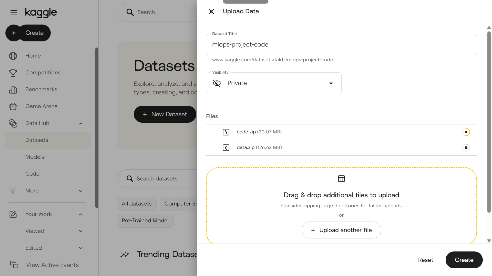
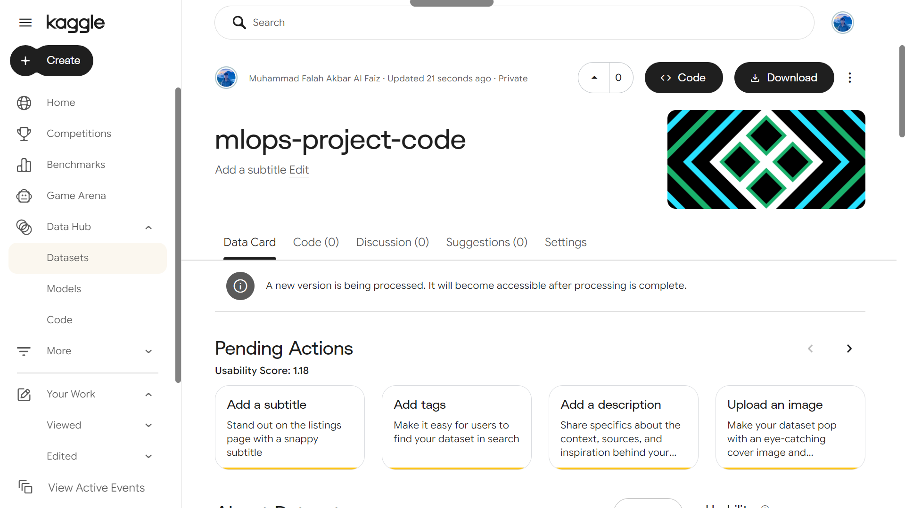
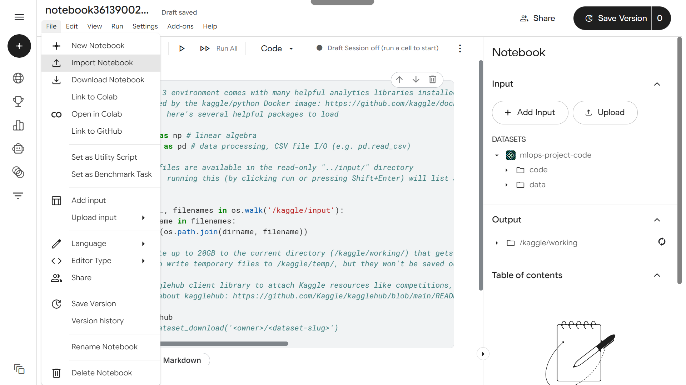
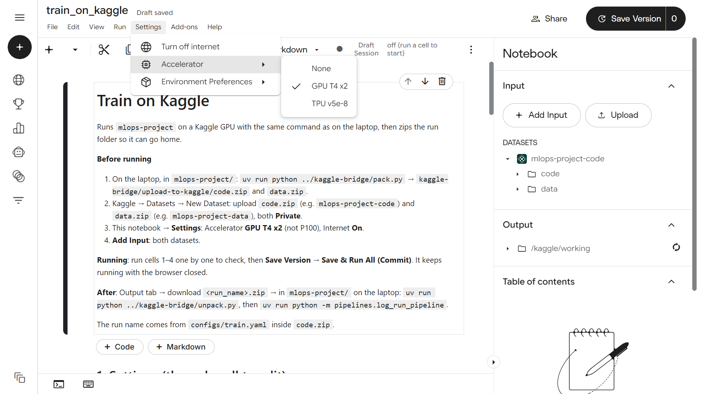
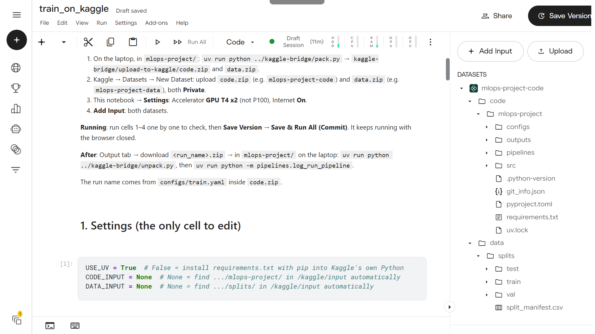
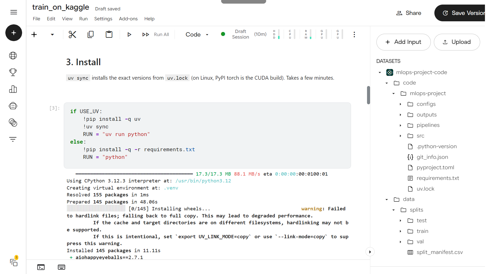
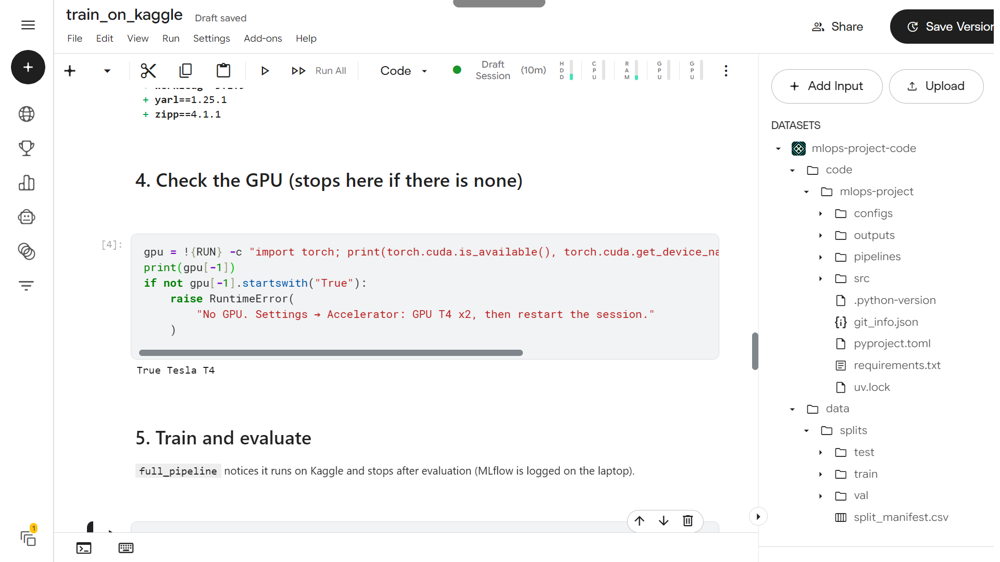
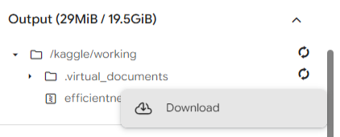

# kaggle-bridge

Moves [`mlops-project`](../mlops-project/) to a free Kaggle GPU and brings the finished run back home. It only moves files: training is the same command as on the laptop, and MLflow logging stays in the project.

```text
 LAPTOP                         KAGGLE                            LAPTOP
 A. pack.py                     C. train_on_kaggle.ipynb          D. unpack.py
    code.zip + data.zip  ─B─►      copy → install → GPU check  ─►  E. log_run_pipeline
                                   → full_pipeline → <run>.zip        → MLflow UI
```

| File | What it does |
| :--- | :--- |
| `pack.py` | Checks the project, then writes `upload-to-kaggle/code.zip` and `data.zip` |
| `train_on_kaggle.ipynb` | Kaggle notebook: copy, install, check GPU, train + evaluate, zip the run folder |
| `unpack.py` | Extracts `download-from-kaggle/<run_name>.zip` into `mlops-project/outputs/runs/<run_name>/` |
| `common.py` | Values shared by `pack.py` and `unpack.py` (project folder name, required run files) |

Standard library only: the bridge has no dependencies of its own. Both scripts run from `mlops-project/` with `uv run python ../kaggle-bridge/<script>.py`.

---

## Before you start

- A Kaggle account with a **verified phone number** (needed for GPU and Internet).
- The project works on the laptop: `data/splits/` exists (`pipelines.data_prep_pipeline`).
- A **new `run_name`** in `mlops-project/configs/train.yaml`, and your changes **committed**. The commit is recorded in the run (`git_commit`, `git_dirty`), so a clean tree makes the run traceable to exact code.

---

## A. Pack (laptop)

```bash
cd mlops-project
uv run python ../kaggle-bridge/pack.py
```

```text
INFO    === Packing for Kaggle ===
INFO    Step 1: Checking mlops-project (run_name: efficientnet_b0_train_kaggle)...
INFO    Step 2: Writing code.zip...
INFO    code.zip: ... files, 19.1 MB
INFO    Step 3: Writing data.zip...
INFO    data.zip: ... files, 120.7 MB
INFO    === Done: upload the zips in .../upload-to-kaggle to Kaggle ===
```

| Zip | Contains | Never contains |
| :--- | :--- | :--- |
| `code.zip` | `configs/`, `src/`, `pipelines/`, `pyproject.toml`, `uv.lock`, `requirements.txt`, `.python-version`, `outputs/pretrained/`, `git_info.json` | `.venv/`, `data/`, `outputs/runs/`, `outputs/mlflow/`, caches |
| `data.zip` | `data/splits/` | `data/raw/` |

`pack.py` stops (exit 1) when `data/splits/` or `uv.lock` is missing, or when `run_name` is already used in `outputs/runs/`. It also:

- refreshes `requirements.txt` from `uv.lock` (for the pip option on Kaggle);
- writes `git_info.json` (commit + uncommitted changes flag), because Kaggle has no `.git`;
- bundles the pretrained weights from `outputs/pretrained/` if they are there;
- rebuilds `data.zip` only when `data/splits/` changed (delete it to force a rebuild).

The zips are written with Python `zipfile`, so paths always use `/`. Kaggle rejects zips made by Windows `Compress-Archive`, which uses `\`.

---

## B. Upload (Kaggle website)

**1. Create two private datasets**, one per zip: Kaggle → **Datasets** → **New Dataset**.

| Dataset | Zip | Upload again when… |
| :--- | :--- | :--- |
| `mlops-project-code` | `code.zip` (~20 MB) | code or configs change (every run) |
| `mlops-project-data` | `data.zip` (~127 MB) | `data/splits/` changes (rarely) |

Keeping them apart means a new run only re-uploads the small code zip. Kaggle unzips both automatically.



Wait until the dataset page stops showing *"A new version is being processed"*. Then open a notebook from it with **Code** → **New Notebook**.



**2. Import the notebook**: **File** → **Import Notebook** → upload `kaggle-bridge/train_on_kaggle.ipynb`.



**3. Settings**: **Accelerator** → **GPU T4 x2**, and turn **Internet on** (for `uv sync`). Avoid P100: recent PyTorch builds no longer support it.



**4. Add Input**: add both datasets. The notebook finds `mlops-project/` and `splits/` anywhere under `/kaggle/input`, so the dataset names do not matter.



**Next runs:** open the code dataset → **New Version** → upload the new `code.zip`. In the notebook, make sure the input uses the latest version.

---

## C. Run (Kaggle notebook)

Only cell 1 has settings, and the defaults work:

```python
USE_UV = True      # False = pip install -r requirements.txt into Kaggle's own Python
CODE_INPUT = None  # None = find .../mlops-project/ in /kaggle/input automatically
DATA_INPUT = None  # None = find .../splits/ in /kaggle/input automatically
```

| Cell | Does |
| :--- | :--- |
| 1. Settings | `USE_UV`, `CODE_INPUT`, `DATA_INPUT` |
| 2. Copy | `/kaggle/input` is read-only, so code and data are copied to `/kaggle/working/mlops-project/` |
| 3. Install | `uv sync` installs the exact versions from `uv.lock` (about 1 minute; on Linux, PyPI torch is the CUDA build) |
| 4. Check GPU | Prints `True Tesla T4`, or stops with a clear error |
| 5. Train and evaluate | `uv run python -m pipelines.full_pipeline`: the same command as on the laptop; on Kaggle it stops after evaluate |
| 6. Zip | `outputs/runs/<run_name>/` → `/kaggle/working/<run_name>.zip`, the working copy is deleted |






**Two ways to run it:**

- **Interactive**: run the cells one by one and keep the tab open. Simple for short runs (the example takes about 5 minutes).
- **Background**: run cells 1–4 to check, then **Save Version** → **Save & Run All (Commit)**. It keeps running with the browser closed; open the saved version to see the log and output.

When cell 6 finishes, download `<run_name>.zip` from the **Output** panel (or the saved version's **Output** tab).



---

## D. Unpack (laptop)

Put the zip in `kaggle-bridge/download-from-kaggle/`, then:

```bash
cd mlops-project
uv run python ../kaggle-bridge/unpack.py              # newest zip in download-from-kaggle/
uv run python ../kaggle-bridge/unpack.py path/to/run.zip
```

```text
INFO    === Unpacking a Kaggle run ===
INFO    Step 1: Reading ...\download-from-kaggle\efficientnet_b0_train_kaggle.zip...
INFO    Step 2: Extracting to ...\outputs\runs\efficientnet_b0_train_kaggle...
INFO    Step 3: Checking the run folder...
INFO    Run efficientnet_b0_train_kaggle: 20 epoch(s) on Tesla T4, best val macro F1 0.9369
INFO    === Done. Next, in mlops-project/: uv run python -m pipelines.log_run_pipeline ===
```

`unpack.py` finds the run by its `run_info.json` (so an extra folder level in the zip is fine), never overwrites an existing run, refuses paths that would land outside the run folder, and checks that `run_info.json`, `history.csv`, `weights/best.pt` and `eval/metrics.json` are there.

---

## E. Log to MLflow (laptop)

```bash
uv run python -m pipelines.log_run_pipeline
uv run mlflow ui --backend-store-uri sqlite:///outputs/mlflow/mlflow.db
```

`log_run_pipeline` reads `run_name` from `configs/train.yaml`. It is still the Kaggle run's name, because `code.zip` was packed from it (`unpack.py` warns if it differs). Open http://127.0.0.1:5000: the Kaggle run sits next to the local runs, logged by the same code.


Pick the best run by a **val** metric, never by test. Its weights stay in `outputs/runs/<run_name>/weights/`.

---

## Checklist

```text
[ ] new run_name in configs/train.yaml, changes committed
[ ] uv run python ../kaggle-bridge/pack.py
[ ] code.zip → code dataset (new version);  data.zip → data dataset (only if splits changed)
[ ] notebook: GPU T4 x2, Internet on, both datasets as input (latest version)
[ ] cells 1–4 OK (True Tesla T4), then run cells 5–6 (or Save & Run All)
[ ] download <run_name>.zip → kaggle-bridge/download-from-kaggle/
[ ] uv run python ../kaggle-bridge/unpack.py
[ ] uv run python -m pipelines.log_run_pipeline
```

---

## Kaggle limits

| Limit | Value (may change, check your Kaggle settings) |
| :--- | :--- |
| GPU quota | about 30 hours per week |
| One session | up to 12 hours |
| `/kaggle/working` | about 20 GB, kept only for saved versions |
| Dataset | private by default; up to 100 GB per dataset |

---

## Troubleshooting

| Problem | Fix |
| :--- | :--- |
| Kaggle: *"forbidden character '\\'"* when uploading a zip | Use the zips from `pack.py`, not ones made by Windows `Compress-Archive` |
| Cell 2: `Expected one .../pyproject.toml in /kaggle/input` | A dataset is missing, still processing, or added twice (old + new version). Fix the **Input** panel, or set `CODE_INPUT` / `DATA_INPUT` to the real path |
| Cell 3: `uv sync` cannot download | Settings → turn Internet on (needs a verified phone number) |
| Cell 3: *"Failed to hardlink files; falling back to full copy"* | Harmless warning: Kaggle's cache and working folder are on different disks |
| Cell 4: `No GPU` | Settings → Accelerator **GPU T4 x2**, then restart the session |
| Cell 5: *"no kernel image is available"* | You are on a P100; switch to GPU T4 x2 |
| Cell 5: `CUDA out of memory` | Lower `batch_size` (or `image_size`) in `train.yaml`, pack again |
| Progress bars look garbled in the Kaggle log | Cosmetic only; the `Epoch n/20 ...` log lines after each epoch are complete |
| Session stopped (12 h limit or browser closed) | Use **Save & Run All (Commit)**; lower `epochs` |
| `unpack.py`: `... already exists. Nothing was changed.` | The run is already unpacked; delete the folder to unpack again |
| `log_run_pipeline` logs the wrong run | Set `run_name` in `train.yaml` to the Kaggle run's name |

---

## Using it for another project

The bridge depends only on two things:

1. The project folder name, `PROJECT_NAME` in `common.py` (written once).
2. The [run folder](../mlops-project/README.md#the-run-folder) contract: a run is a folder with `run_info.json`, `history.csv`, `weights/best.pt`, `eval/metrics.json`.

Any project that is run with `uv run python -m pipelines.full_pipeline` and writes that folder can use the bridge unchanged.
