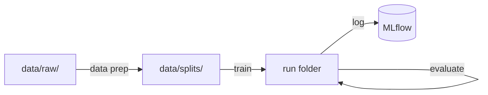

# mlops-project

A small, complete MLOps project for **image classification**: from a folder of images to a tracked, reproducible model. It runs on your laptop, and the exact same command runs on a borrowed Kaggle GPU when training needs more power.

The example data is the [Flowers dataset](https://www.tensorflow.org/datasets/catalog/tf_flowers) (5 classes, CC BY 2.0), but nothing in the code is about flowers. **Put your own images in `data/raw/<class>/` and the whole pipeline works unchanged.**



---

## Quickstart

Requires Python 3.11+ and [uv](https://docs.astral.sh/uv/). From the `mlops-project/` folder:

```bash
uv sync                                          # install
uv run python -m pipelines.download_pipeline     # example data → data/raw/ (~220 MB)
uv run python -m pipelines.data_prep_pipeline    # clean + split → data/splits/
uv run python -m pipelines.full_pipeline         # train → evaluate → log to MLflow
uv run mlflow ui --backend-store-uri sqlite:///outputs/mlflow/mlflow.db
```

Open http://127.0.0.1:5000 to see the run.

> **First time?** Set `epochs: 1` in `configs/train.yaml` for a quick check. One epoch takes about 8 minutes on a laptop CPU (Intel i5-8265U). For the full 20 epochs, borrow a Kaggle GPU with [`../kaggle-bridge/`](../kaggle-bridge/) (about 5 minutes on a GPU T4 x2).

---

## Use your own data

| You want to… | Do this | Code changes |
| :--- | :--- | :--- |
| Train on your own images | Put them in `data/raw/<class_name>/`, skip the download | None |
| Tune training | Edit `configs/train.yaml` (`backbone`, `image_size`, `epochs`, `lr`, …) | None |
| Try another model | Set `backbone` to any [torchvision classification model](https://pytorch.org/vision/stable/models.html#classification), e.g. `resnet18`, `convnext_tiny` | None |
| Solve another task (tabular, NLP, detection) | Replace `src/data/`, `src/models/`, `src/evaluation/` | Yes, but keep writing the same [run folder](#the-run-folder) |

Any folder name becomes a class. Files outside the class folders (like a `LICENSE.txt`) are ignored, and unreadable images are skipped and logged.

---

## How it works

### Pipelines

Each pipeline is one `run_xxx()` function with numbered, logged steps. Every stage reads and writes files, so each one can also run on its own.

| Command (`uv run python -m …`) | What it does |
| :--- | :--- |
| `pipelines.download_pipeline` | Downloads the example dataset into `data/raw/` (skipped if images are already there) |
| `pipelines.data_prep_pipeline` | Drops unreadable files, splits 70/15/15 stratified by class, saves RGB images (shorter side ≤ 224 px), writes `split_manifest.csv`, validates counts and leakage |
| `pipelines.train_pipeline` | Fine-tunes a pretrained model with early stopping on val macro F1, writes the run folder |
| `pipelines.evaluate_pipeline` | Scores val and test: accuracy, macro F1, per-class metrics, confusion matrices, predictions |
| `pipelines.log_run_pipeline` | Logs a finished run folder to the local MLflow (params, curves, metrics, files) |
| `pipelines.full_pipeline` | Train → evaluate → log. On Kaggle it stops after evaluate |

### Laptop or Kaggle

`full_pipeline` notices where it runs:

- **On the laptop**, the run is logged to MLflow automatically.
- **On Kaggle**, there is no local MLflow, so it stops after evaluate. Bring the run folder home (see [`../kaggle-bridge/`](../kaggle-bridge/)), unzip it into `outputs/runs/`, then run `pipelines.log_run_pipeline`.

Both kinds of runs look the same in MLflow, because both are logged by the same code from the same run folder.

### The run folder

Every training run writes one self-contained folder. It is the **single source of truth**; MLflow is only an index built from it.

```text
outputs/runs/<run_name>/
├── run_info.json     # model, classes, image size, data fingerprint, platform, GPU, versions, git commit
├── config/           # copies of train.yaml and dataset.yaml used for this run
├── history.csv       # loss, accuracy, macro F1 per epoch
├── weights/          # best.pt (best val macro F1), last.pt — state_dict only
└── eval/             # metrics.json, confusion_matrix_{val,test}.png, predictions_{val,test}.csv
```

To load a trained model anywhere:

```python
import json
from pathlib import Path

import torch

from src.models.factory import build_model

run_dir = Path("outputs/runs/<run_name>")
info = json.loads((run_dir / "run_info.json").read_text())
model = build_model(info["backbone"], info["num_classes"], pretrained=False)
model.load_state_dict(torch.load(run_dir / "weights/best.pt", weights_only=True))
model.eval()
```

Inputs must be prepared like evaluation images: `build_eval_transform(info["image_size"])` from `src/preprocessing/transforms.py`. Class index `i` is `info["class_names"][i]`.

### Choosing a model

The main metric is **val macro F1**: every class counts equally, so a weak small class cannot hide behind a strong large one. It drives early stopping and model choice. **The test set is only reported, never used to choose.**

---

## Configuration

All settings live in `configs/`. Each file is validated by a Pydantic schema in `src/core/config.py`, so a misspelled key or a wrong type fails before any work starts.

| File | Key settings |
| :--- | :--- |
| `dataset.yaml` | `url`, `seed`, `split_ratio` (70/15/15), `save_size` (224), `overwrite` |
| `train.yaml` | **`run_name`**, `backbone`, `pretrained`, `image_size`, `epochs`, `batch_size`, `lr`, `patience`, `device`, `seed` |
| `evaluate.yaml` | `weights` (`best` or `last`), `batch_size` |
| `tracking.yaml` | `use_mlflow` (`false` = runs stay in `outputs/runs/` only) |

`run_name` is written **in one place only**, `train.yaml`; evaluate and log read it from there. Use a new name for every run: training refuses a name that already exists, so no result is ever overwritten.

---

## Project structure

```text
mlops-project/
├── configs/          # values: one YAML per stage
├── notebooks/        # 01_exploratory_data_analysis.ipynb
├── pipelines/        # flow: run_xxx() with numbered steps, no logic
├── src/              # logic: small functions that take values and return results
│   ├── core/         #   paths, config schemas, logger, seed/device/environment
│   ├── data/         #   download, cleaning, splitting, validation
│   ├── preprocessing/#   transforms, datasets and loaders
│   ├── models/       #   build_model()
│   ├── training/     #   train loop with early stopping
│   ├── evaluation/   #   prediction, metrics, confusion matrix plot
│   └── tracking/     #   run folder format, MLflow logging
├── tests/            # pytest: data, config, model, end-to-end smoke test
├── data/             # raw/ and splits/ (not tracked by git)
└── outputs/          # runs/, mlflow/, pretrained/ (not tracked by git)
```

Three rules keep it easy to change:

1. **`src/` never reads YAML or decides the flow**; `pipelines/` never holds logic.
2. **Each fact is written once**: folders in `src/core/paths.py`, the run folder layout in `src/tracking/run_folder.py`, and MLflow only in `src/tracking/mlflow_logger.py`.
3. **Nothing is overwritten silently**: data prep refuses a non-empty `data/splits/` (unless `overwrite: true`), training refuses an existing `run_name`, logging refuses a run already in MLflow.

---

## The example: Flowers

Findings from the EDA notebook ([`notebooks/01_exploratory_data_analysis.ipynb`](notebooks/01_exploratory_data_analysis.ipynb)) and the decisions they led to:

| Finding | Decision |
| :--- | :--- |
| 3,670 JPGs, 5 classes, 0 unreadable files, all RGB | No class merging; unreadable/non-RGB handling stays as a safety net |
| Mild imbalance (largest/smallest = 1.42) | Stratified split, no class weights; macro F1 as the main metric |
| Median shorter side 240 px; 27% are below 224 px | Save at shorter side 224 (shrink only, never upscale), train at 224 |
| No official train/val/test split | Stratified 70/15/15 with seed 42 |

| Class | Train | Val | Test | Total |
| :--- | ---: | ---: | ---: | ---: |
| daisy | 443 | 95 | 95 | 633 |
| dandelion | 629 | 134 | 135 | 898 |
| roses | 449 | 96 | 96 | 641 |
| sunflowers | 489 | 105 | 105 | 699 |
| tulips | 559 | 120 | 120 | 799 |
| **Total** | **2,569** | **550** | **551** | **3,670** |

**Model:** `efficientnet_b0` pretrained on ImageNet (5.3 M parameters, 0.39 GFLOPs), last layer resized to the number of classes. Adam, cross-entropy, augmentation `RandomResizedCrop` + horizontal flip.

### Results

| Run | Where | Epochs | Time | Val acc | Val macro F1 | Test acc | Test macro F1 |
| :--- | :--- | ---: | ---: | ---: | ---: | ---: | ---: |
| `efficientnet_b0_1_epoch` | Laptop CPU (i5-8265U) | 1 | 8 min | 0.887 | 0.884 | 0.893 | 0.892 |
| `efficientnet_b0_train_kaggle` | Kaggle GPU T4 x2 | 20 (best: 15) | 4.6 min | **0.938** | **0.937** | **0.935** | **0.935** |

One epoch already reaches 0.88 macro F1 thanks to the pretrained weights. The full run took about 14 seconds per epoch on the Kaggle GPU T4 x2, against 8 minutes per epoch on the laptop CPU. The weights of epoch 15 (best val macro F1) are used for evaluation; test was scored once, after the choice.

---

## Testing

```bash
uv run python -m pytest       # 13 tests, about 30 seconds, CPU only
uv run ruff check .
uv run ruff format --check .
```

The smoke test runs data prep → train → evaluate → MLflow on 60 generated images in a temporary folder, and checks the Kaggle path too. It never touches your `data/` or `outputs/` and downloads nothing.

On Windows, use `uv run python -m pytest`: plain `uv run pytest` can fail because of the uv launcher.

---

## Troubleshooting

| Message | Fix |
| :--- | :--- |
| `outputs/runs/<name> already exists` | Change `run_name` in `configs/train.yaml` |
| `data/splits already has files` | Set `overwrite: true` in `dataset.yaml` to rebuild it |
| `data/raw not found` / `Need at least 2 class folders` | Run the download, or put images in `data/raw/<class>/` |
| `Run '<name>' is already in MLflow` | The run is logged already; nothing to do |
| `eval/metrics.json not found` | Run `pipelines.evaluate_pipeline` before logging |
| `device 'cuda' requested but no GPU` | Use `device: auto` |
